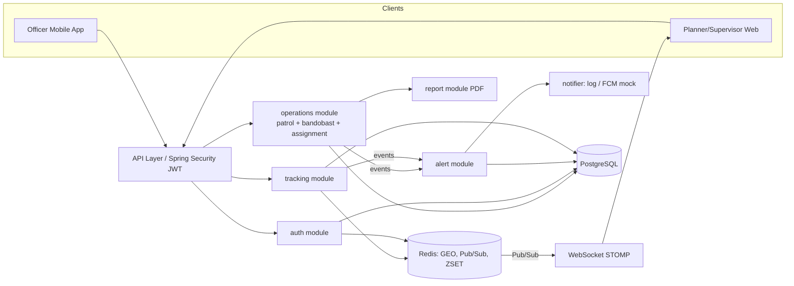
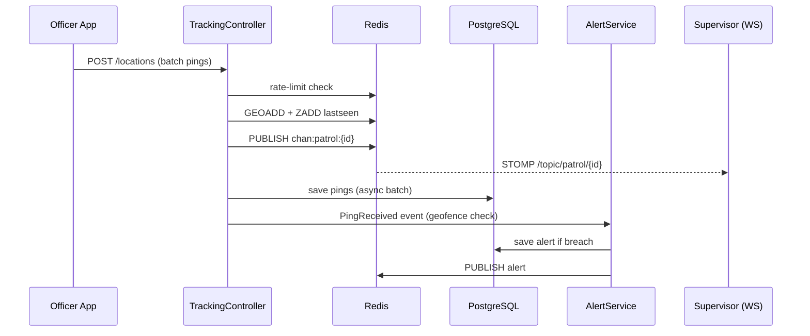

# CopMap Backend – Patrolling & Bandobast/Nakabandi

> Implementation plan: flow-by-flow architecture, folder structure, code layout, build steps.
> Stack: **Java 21, Spring Boot 3.x, PostgreSQL, Redis, Docker.**

---

## 1. Scope Decision

| Area | Status |
|---|---|
| Patrol lifecycle with live tracking (plan → assign → start → track → alert → close → PDF) | **Implemented end to end** |
| Auth + RBAC (JWT, 3 roles) | **Implemented (simple)** |
| Bandobast / Nakabandi | **Designed fully (schema, APIs, flows), only skeleton code** |
| Microservice split | **Documented boundaries; delivered as a modular monolith** |
| FCM / WhatsApp | **Mock notifier (logs)** |

**Trade-off to state in README:** a modular monolith keeps the demo runnable with one `docker compose up`. Each module has its own package, its own tables, and talks to others only through service interfaces or domain events, so it can be split into services later without rewriting.

---

## 2. Domain Research (write this in your own words)

Keep it short and factual. Cover:

- **Patrolling:** officers cover an assigned beat or route on foot or vehicle (e.g. beat patrol, PCR/mobile patrol), checking points, reporting issues, during a shift.
- **Bandobast:** a planned deployment of force for an event, VIP movement, festival, or election. Points/sectors are defined, officers are assigned to each with time windows, and a commander oversees.
- **Nakabandi:** a static checkpoint on a road. Officers check vehicles at a fixed location for a time window.
- **Who plans / executes / monitors:** Station officer or inspector plans; constables and SIs execute on ground; supervisors (DySP/SP control room) monitor and review.
- **Assignment:** by shift, area/beat, rank, and availability, with no double-booking.

Add 1–2 real-world sources or a conversation with someone who knows the workflow. The task rejects generic content.

---

## 3. Actors & RBAC

| Role | Who | Can do |
|---|---|---|
| `OFFICER` | Constable / SI on ground | View own assignments, start/end own duty, send location, raise SOS, check in at points |
| `PLANNER` | Station officer / inspector | Create and edit plans, assign officers, publish, close own-station operations |
| `SUPERVISOR` | DySP / SP / control room | Monitor all operations in jurisdiction (read-only live map), acknowledge alerts, close/override, download reports |

**Auth assumptions**
- Login with `badgeNo` + password → JWT (access 15 min + refresh token).
- JWT claims: `sub=userId`, `role`, `stationId`, `jti`.
- Data scoping: Planner is limited to own `stationId`; Supervisor to a list of stations; Officer to own assignments.
- Logout puts `jti` in a Redis blacklist until token expiry.

**Permission matrix**

| Action | OFFICER | PLANNER | SUPERVISOR |
|---|:-:|:-:|:-:|
| Create patrol/bandobast | ✗ | ✓ | ✓ |
| Assign officers | ✗ | ✓ | ✓ |
| Start / end own duty | ✓ | ✗ | ✗ |
| Send location / SOS | ✓ | ✗ | ✗ |
| Live monitor | own only | own station | all in scope |
| Acknowledge alerts | ✗ | ✓ | ✓ |
| Close operation | ✗ | ✓ | ✓ |
| Generate PDF | ✗ | ✓ | ✓ |
| View audit trail | ✗ | station | all |

---

## 4. Architecture

### 4.1 Logical services (boundaries)



| Module (future service) | Owns | Talks via |
|---|---|---|
| `auth` | users, stations, tokens | REST |
| `operations` | patrols, bandobast, assignments, audit | REST + domain events |
| `tracking` | location pings, live positions | REST ingest, Redis, WebSocket |
| `alert` | alerts, rules, notifications | consumes events |
| `report` | PDF generation | called by operations |

### 4.2 Real-time mechanism

- **WebSocket (STOMP)** for live map: `/topic/patrol/{id}`.
- **Polling fallback:** `GET /api/v1/patrols/{id}/live` returns the latest snapshot (also the initial load).
- **Internal events:** Spring `ApplicationEventPublisher` now; swap for Kafka/RabbitMQ when split.
- Officer → server is plain REST batches (mobile networks are flaky; batching with a client timestamp is simpler than a persistent socket).

### 4.3 Redis usage

| Key / feature | Type | Why |
|---|---|---|
| `live:patrol:{patrolId}` | GEO | Latest position per officer, O(1) read for the map, supports radius queries |
| `lastseen:patrol:{patrolId}` | ZSET (score = epoch ms) | Detect missing signal via a scheduled sweeper (more reliable than key-expiry events) |
| `chan:patrol:{patrolId}` | Pub/Sub | Fan-out new positions/alerts to every WebSocket instance (scales horizontally) |
| `rl:loc:{officerId}` | counter + TTL | Rate-limit ping flood |
| `jwt:bl:{jti}` | key + TTL | Logout / token revocation |
| `alert:dedupe:{patrolId}:{type}:{officerId}` | key + TTL | Don't spam the same alert every ping |

---

## 5. Flows

### Flow 1 – Login
`POST /auth/login` → verify badge+password (BCrypt) → issue JWT → client stores token.

### Flow 2 – Plan a patrol (Planner)
```
DRAFT --publish--> PLANNED --first officer starts--> ACTIVE --close--> COMPLETED
                      \--cancel--> CANCELLED
```
1. `POST /patrols` (title, shift start/end, waypoints, geofence radius).
2. Validate planner role + station.
3. Save patrol + waypoints, status `DRAFT`, write audit.
4. `POST /patrols/{id}/publish` → `PLANNED`.

### Flow 3 – Assign officers
1. `POST /patrols/{id}/assignments` with `officerIds[]`.
2. Check each officer belongs to the station and has **no overlapping assignment** (query by time range).
3. Save assignments (`ASSIGNED`), publish `OfficerAssigned` event.
4. Notification listener sends a mock push/log.

### Flow 4 – Officer starts duty
1. `POST /patrols/{id}/start` (officer must be assigned).
2. Assignment → `ON_DUTY`; patrol → `ACTIVE` if first.
3. Redis: init `lastseen` entry; audit entry.

### Flow 5 – Live location


### Flow 6 – Alerts
| Type | Trigger |
|---|---|
| `GEOFENCE_BREACH` | Ping farther than `radius` from route |
| `NO_SIGNAL` | Sweeper finds `lastseen` older than N minutes |
| `SOS` | `POST /alerts/sos` by officer |
| `LATE_START` | Assignment not started X min after shift start |

Alerts are deduped through Redis, stored in DB, pushed over WebSocket, sent to the notifier, then acknowledged by planner/supervisor (`POST /alerts/{id}/ack`).

### Flow 7 – Close & report
1. `POST /patrols/{id}/close` (remarks required).
2. All assignments → `COMPLETED`; patrol → `COMPLETED`; Redis keys cleaned.
3. Audit entry; `GET /patrols/{id}/report.pdf` builds the PDF (details, officers, route, timeline, alerts).

### Flow 8 – Bandobast / Nakabandi (design only)
- `bandobast_operations` (event, date range, commander) → `bandobast_points` (nakabandi spot or sector, lat/lng, required strength) → `duty_slots` (point + officer + time window).
- Officers **check in** at their point (`POST /bandobast/{id}/points/{pid}/checkin` with GPS verified against point radius).
- Same assignment-conflict, alert, closure, and report engine.

---

## 6. Data Design

```sql
-- auth
CREATE TABLE stations (
  id BIGSERIAL PRIMARY KEY, name VARCHAR(120) NOT NULL, district VARCHAR(80)
);
CREATE TABLE users (
  id BIGSERIAL PRIMARY KEY,
  badge_no VARCHAR(30) UNIQUE NOT NULL,
  full_name VARCHAR(120) NOT NULL,
  rank VARCHAR(40),
  role VARCHAR(20) NOT NULL,           -- OFFICER | PLANNER | SUPERVISOR
  station_id BIGINT REFERENCES stations(id),
  password_hash VARCHAR(100) NOT NULL,
  active BOOLEAN DEFAULT TRUE
);

-- operations: patrol
CREATE TABLE patrols (
  id BIGSERIAL PRIMARY KEY,
  title VARCHAR(160) NOT NULL,
  type VARCHAR(20) NOT NULL,           -- FOOT | VEHICLE
  station_id BIGINT NOT NULL REFERENCES stations(id),
  status VARCHAR(20) NOT NULL,         -- DRAFT|PLANNED|ACTIVE|COMPLETED|CANCELLED
  shift_start TIMESTAMPTZ NOT NULL,
  shift_end TIMESTAMPTZ NOT NULL,
  geofence_radius_m INT DEFAULT 200,
  created_by BIGINT NOT NULL REFERENCES users(id),
  closed_by BIGINT REFERENCES users(id),
  close_remarks TEXT,
  created_at TIMESTAMPTZ DEFAULT now()
);
CREATE TABLE patrol_waypoints (
  id BIGSERIAL PRIMARY KEY,
  patrol_id BIGINT REFERENCES patrols(id) ON DELETE CASCADE,
  seq INT NOT NULL, name VARCHAR(120),
  lat DOUBLE PRECISION NOT NULL, lng DOUBLE PRECISION NOT NULL
);

-- operations: bandobast (design)
CREATE TABLE bandobast_operations (
  id BIGSERIAL PRIMARY KEY, title VARCHAR(160) NOT NULL, kind VARCHAR(20), -- BANDOBAST|NAKABANDI
  station_id BIGINT REFERENCES stations(id), status VARCHAR(20),
  starts_at TIMESTAMPTZ, ends_at TIMESTAMPTZ, commander_id BIGINT REFERENCES users(id)
);
CREATE TABLE bandobast_points (
  id BIGSERIAL PRIMARY KEY, operation_id BIGINT REFERENCES bandobast_operations(id),
  name VARCHAR(120), lat DOUBLE PRECISION, lng DOUBLE PRECISION,
  radius_m INT DEFAULT 100, required_strength INT DEFAULT 1
);

-- assignments (shared by patrol & bandobast)
CREATE TABLE assignments (
  id BIGSERIAL PRIMARY KEY,
  officer_id BIGINT NOT NULL REFERENCES users(id),
  operation_type VARCHAR(20) NOT NULL,  -- PATROL | BANDOBAST
  operation_id BIGINT NOT NULL,
  point_id BIGINT,                       -- for bandobast
  starts_at TIMESTAMPTZ NOT NULL, ends_at TIMESTAMPTZ NOT NULL,
  status VARCHAR(20) NOT NULL,           -- ASSIGNED|ON_DUTY|COMPLETED|MISSED
  started_at TIMESTAMPTZ, ended_at TIMESTAMPTZ
);
CREATE INDEX idx_assign_officer_time ON assignments(officer_id, starts_at, ends_at);

-- tracking
CREATE TABLE location_pings (
  id BIGSERIAL PRIMARY KEY,
  officer_id BIGINT NOT NULL, patrol_id BIGINT NOT NULL,
  lat DOUBLE PRECISION NOT NULL, lng DOUBLE PRECISION NOT NULL,
  accuracy_m REAL, speed_mps REAL,
  recorded_at TIMESTAMPTZ NOT NULL, received_at TIMESTAMPTZ DEFAULT now()
);
CREATE INDEX idx_ping_patrol_time ON location_pings(patrol_id, recorded_at);
CREATE UNIQUE INDEX uq_ping_officer_patrol_time ON location_pings(officer_id, patrol_id, recorded_at);

-- alerts & audit
CREATE TABLE alerts (
  id BIGSERIAL PRIMARY KEY, type VARCHAR(30) NOT NULL, severity VARCHAR(10),
  operation_type VARCHAR(20), operation_id BIGINT, officer_id BIGINT,
  message TEXT, lat DOUBLE PRECISION, lng DOUBLE PRECISION,
  status VARCHAR(15) DEFAULT 'OPEN',    -- OPEN|ACKED|RESOLVED
  acked_by BIGINT, acked_at TIMESTAMPTZ, created_at TIMESTAMPTZ DEFAULT now()
);
CREATE TABLE audit_logs (
  id BIGSERIAL PRIMARY KEY, actor_id BIGINT, action VARCHAR(60) NOT NULL,
  entity_type VARCHAR(30), entity_id BIGINT, details JSONB, created_at TIMESTAMPTZ DEFAULT now()
);
```

**Scaling note:** `location_pings` is the high-volume table. Partition by day (or move to TimescaleDB) and keep only the latest position in Redis.

---

## 7. API Contracts (`/api/v1`)

All responses use one envelope:

```json
{ "success": true, "data": { }, "error": null, "timestamp": "2026-11-05T10:00:00Z" }
```

| Method | Path | Role | Purpose |
|---|---|---|---|
| POST | `/auth/login` | public | Login, returns JWT |
| POST | `/auth/logout` | any | Blacklist token |
| POST | `/patrols` | PLANNER+ | Create patrol (DRAFT) |
| GET | `/patrols?status=&date=&page=` | any (scoped) | List |
| GET | `/patrols/{id}` | scoped | Detail with waypoints and assignments |
| POST | `/patrols/{id}/publish` | PLANNER+ | DRAFT → PLANNED |
| POST | `/patrols/{id}/assignments` | PLANNER+ | Assign officers |
| GET | `/me/assignments` | OFFICER | My duties |
| POST | `/patrols/{id}/start` | OFFICER | Start duty |
| POST | `/patrols/{id}/end` | OFFICER | End own duty |
| POST | `/locations` | OFFICER | Batch location ingest |
| GET | `/patrols/{id}/live` | PLANNER+ | Latest positions snapshot |
| WS | `/ws` → `/topic/patrol/{id}` | PLANNER+ | Live stream |
| POST | `/alerts/sos` | OFFICER | Raise SOS |
| GET | `/alerts?status=OPEN` | PLANNER+ | List alerts |
| POST | `/alerts/{id}/ack` | PLANNER+ | Acknowledge |
| POST | `/patrols/{id}/close` | PLANNER+ | Close with remarks |
| GET | `/patrols/{id}/report.pdf` | PLANNER+ | Download report |
| GET | `/patrols/{id}/audit` | PLANNER+ | Audit trail |

**Sample: create patrol**
```json
POST /api/v1/patrols
{
  "title": "Night Beat 3 - Market Area",
  "type": "FOOT",
  "shiftStart": "2026-11-06T22:00:00+05:30",
  "shiftEnd": "2026-11-07T04:00:00+05:30",
  "geofenceRadiusM": 150,
  "waypoints": [
    { "seq": 1, "name": "Main Chowk", "lat": 28.6139, "lng": 77.2090 },
    { "seq": 2, "name": "Bus Stand", "lat": 28.6170, "lng": 77.2130 }
  ]
}
```

**Sample: location batch**
```json
POST /api/v1/locations
{
  "patrolId": 12,
  "pings": [
    { "lat": 28.6141, "lng": 77.2092, "accuracy": 8.5, "speed": 1.2, "recordedAt": "2026-11-06T22:05:10+05:30" }
  ]
}
```

**Frontend considerations (mention in README):** paginated lists, a consistent error envelope with machine-readable `error.code`, ISO-8601 timestamps with offset, idempotent ping ingest (client `recordedAt` + officer is the dedupe key), and a `/live` snapshot so the map renders before the socket connects.

---

## 8. Folder Structure (complete)

```
copmap-backend/
├── .gitignore
├── .dockerignore
├── .env.example                      # DB_URL, DB_USER, DB_PASS, REDIS_HOST, JWT_SECRET ...
├── Dockerfile
├── docker-compose.yml
├── mvnw / mvnw.cmd                   # Maven wrapper
├── .mvn/wrapper/maven-wrapper.properties
├── pom.xml
├── README.md
│
├── docs/
│   ├── research.md                   # your own patrol / bandobast / nakabandi research
│   ├── architecture.md               # module boundaries, trade-offs
│   ├── api-contracts.md              # request/response samples
│   ├── diagrams/
│   │   ├── architecture.png
│   │   ├── er-diagram.png
│   │   ├── flow-live-tracking.png
│   │   ├── flow-patrol-lifecycle.png
│   │   └── src/                      # .mmd / draw.io sources
│   └── postman/
│       ├── CopMap.postman_collection.json
│       └── CopMap.postman_environment.json
│
├── scripts/
│   ├── seed-demo.sh                  # optional: calls APIs to build a demo patrol
│   └── simulate-officer.py           # optional: posts fake GPS pings for the demo video
│
└── src/
    ├── main/
    │   ├── java/in/copmap/
    │   │   ├── CopMapApplication.java
    │   │   │
    │   │   ├── common/
    │   │   │   ├── api/
    │   │   │   │   ├── ApiResponse.java
    │   │   │   │   ├── ApiError.java
    │   │   │   │   └── PageResponse.java
    │   │   │   ├── exception/
    │   │   │   │   ├── BusinessException.java
    │   │   │   │   ├── ErrorCode.java
    │   │   │   │   └── GlobalExceptionHandler.java
    │   │   │   ├── audit/
    │   │   │   │   ├── AuditLog.java
    │   │   │   │   ├── AuditLogRepository.java
    │   │   │   │   ├── AuditService.java
    │   │   │   │   └── AuditController.java
    │   │   │   └── util/
    │   │   │       ├── GeoUtils.java
    │   │   │       └── TimeUtils.java
    │   │   │
    │   │   ├── config/
    │   │   │   ├── SecurityConfig.java
    │   │   │   ├── RedisConfig.java            # templates + Pub/Sub listener container
    │   │   │   ├── WebSocketConfig.java
    │   │   │   ├── WebSocketAuthInterceptor.java   # validates JWT on STOMP CONNECT
    │   │   │   ├── AsyncConfig.java            # executor for ping persistence
    │   │   │   ├── SchedulingConfig.java
    │   │   │   ├── OpenApiConfig.java
    │   │   │   └── AppProperties.java          # @ConfigurationProperties (jwt, tracking, alerts)
    │   │   │
    │   │   ├── auth/
    │   │   │   ├── controller/AuthController.java
    │   │   │   ├── service/
    │   │   │   │   ├── AuthService.java
    │   │   │   │   ├── JwtService.java
    │   │   │   │   └── TokenBlacklistService.java    # Redis
    │   │   │   ├── security/
    │   │   │   │   ├── JwtAuthFilter.java
    │   │   │   │   ├── AuthUser.java                 # principal record
    │   │   │   │   └── RestAuthEntryPoint.java
    │   │   │   ├── domain/
    │   │   │   │   ├── User.java
    │   │   │   │   ├── Station.java
    │   │   │   │   └── Role.java
    │   │   │   ├── repository/
    │   │   │   │   ├── UserRepository.java
    │   │   │   │   └── StationRepository.java
    │   │   │   └── dto/
    │   │   │       ├── LoginRequest.java
    │   │   │       ├── LoginResponse.java
    │   │   │       └── UserResponse.java
    │   │   │
    │   │   ├── operations/
    │   │   │   ├── patrol/
    │   │   │   │   ├── controller/PatrolController.java
    │   │   │   │   ├── service/
    │   │   │   │   │   ├── PatrolService.java
    │   │   │   │   │   └── PatrolStateMachine.java
    │   │   │   │   ├── domain/
    │   │   │   │   │   ├── Patrol.java
    │   │   │   │   │   ├── PatrolWaypoint.java
    │   │   │   │   │   ├── PatrolStatus.java
    │   │   │   │   │   └── PatrolType.java
    │   │   │   │   ├── repository/PatrolRepository.java
    │   │   │   │   ├── mapper/PatrolMapper.java
    │   │   │   │   └── dto/
    │   │   │   │       ├── CreatePatrolRequest.java
    │   │   │   │       ├── WaypointDto.java
    │   │   │   │       ├── PatrolResponse.java
    │   │   │   │       └── ClosePatrolRequest.java
    │   │   │   ├── assignment/
    │   │   │   │   ├── controller/AssignmentController.java
    │   │   │   │   ├── service/
    │   │   │   │   │   ├── AssignmentService.java
    │   │   │   │   │   └── ConflictChecker.java
    │   │   │   │   ├── domain/
    │   │   │   │   │   ├── Assignment.java
    │   │   │   │   │   ├── AssignmentStatus.java
    │   │   │   │   │   └── OperationType.java
    │   │   │   │   ├── repository/AssignmentRepository.java
    │   │   │   │   └── dto/
    │   │   │   │       ├── AssignOfficersRequest.java
    │   │   │   │       └── AssignmentResponse.java
    │   │   │   ├── bandobast/                       # skeleton: schema + stubs, logic documented
    │   │   │   │   ├── controller/BandobastController.java
    │   │   │   │   ├── service/BandobastService.java      # TODO
    │   │   │   │   ├── domain/
    │   │   │   │   │   ├── BandobastOperation.java
    │   │   │   │   │   ├── BandobastPoint.java
    │   │   │   │   │   └── OperationKind.java             # BANDOBAST | NAKABANDI
    │   │   │   │   ├── repository/
    │   │   │   │   │   ├── BandobastOperationRepository.java
    │   │   │   │   │   └── BandobastPointRepository.java
    │   │   │   │   └── dto/
    │   │   │   │       ├── CreateBandobastRequest.java
    │   │   │   │       └── CheckInRequest.java
    │   │   │   └── events/
    │   │   │       ├── OfficerAssignedEvent.java
    │   │   │       ├── DutyStartedEvent.java
    │   │   │       └── PatrolClosedEvent.java
    │   │   │
    │   │   ├── tracking/
    │   │   │   ├── controller/TrackingController.java
    │   │   │   ├── service/
    │   │   │   │   ├── TrackingService.java
    │   │   │   │   ├── PingRateLimiter.java
    │   │   │   │   └── PingPersistenceWorker.java    # @Async batch insert
    │   │   │   ├── redis/
    │   │   │   │   ├── LivePositionStore.java        # GEO + ZSET
    │   │   │   │   ├── LivePublisher.java            # Pub/Sub publish
    │   │   │   │   └── RedisLiveSubscriber.java      # Pub/Sub -> STOMP
    │   │   │   ├── domain/LocationPing.java
    │   │   │   ├── repository/LocationPingRepository.java
    │   │   │   ├── events/PingReceivedEvent.java
    │   │   │   └── dto/
    │   │   │       ├── PingBatchRequest.java
    │   │   │       ├── PingDto.java
    │   │   │       └── LivePositionResponse.java
    │   │   │
    │   │   ├── alert/
    │   │   │   ├── controller/AlertController.java
    │   │   │   ├── service/AlertService.java
    │   │   │   ├── rules/
    │   │   │   │   ├── GeofenceRule.java
    │   │   │   │   ├── NoSignalSweeper.java
    │   │   │   │   └── LateStartSweeper.java
    │   │   │   ├── domain/
    │   │   │   │   ├── Alert.java
    │   │   │   │   ├── AlertType.java
    │   │   │   │   ├── AlertSeverity.java
    │   │   │   │   └── AlertStatus.java
    │   │   │   ├── repository/AlertRepository.java
    │   │   │   ├── notify/
    │   │   │   │   ├── Notifier.java                 # interface
    │   │   │   │   ├── LogNotifier.java
    │   │   │   │   ├── FcmNotifierMock.java
    │   │   │   │   └── NotificationMessage.java
    │   │   │   └── dto/
    │   │   │       ├── AlertResponse.java
    │   │   │       └── SosRequest.java
    │   │   │
    │   │   └── report/
    │   │       ├── controller/ReportController.java
    │   │       ├── service/PatrolReportService.java  # OpenPDF
    │   │       └── model/PatrolReportModel.java
    │   │
    │   └── resources/
    │       ├── application.yml
    │       ├── application-docker.yml
    │       ├── application-dev.yml
    │       ├── logback-spring.xml
    │       └── db/migration/
    │           ├── V1__auth.sql
    │           ├── V2__patrol.sql
    │           ├── V3__assignments.sql
    │           ├── V4__tracking_alerts_audit.sql
    │           ├── V5__bandobast.sql
    │           └── V6__seed_data.sql
    │
    └── test/
        ├── java/in/copmap/
        │   ├── support/
        │   │   ├── AbstractIntegrationTest.java      # Testcontainers: Postgres + Redis
        │   │   └── TestTokens.java                   # helper to mint JWTs per role
        │   ├── auth/RbacIT.java
        │   ├── operations/
        │   │   ├── patrol/PatrolStateMachineTest.java
        │   │   └── assignment/ConflictCheckerTest.java
        │   ├── tracking/TrackingServiceIT.java
        │   └── alert/rules/GeofenceRuleTest.java
        └── resources/
            └── application-test.yml
```

**Why this shape:** each top-level package (`auth`, `operations`, `tracking`, `alert`, `report`) is a future microservice. Inside, code is layered as `controller → service → repository` with `domain`, `dto`, and `events` kept separate. Cross-module calls go through services or events, never another module's repository.

---

## 9. How the Code Will Look

### 9.1 Layering rules
- **Controller** → validates input, extracts the principal, calls the service. No business logic.
- **Service** → business rules, transactions, publishes events.
- **Repository** → Spring Data JPA only.
- **DTOs** are separate from entities; map with a small mapper or records.
- Modules interact via **services/events**, never another module's repository.

### 9.2 Full `pom.xml`

```xml
<?xml version="1.0" encoding="UTF-8"?>
<project xmlns="http://maven.apache.org/POM/4.0.0"
         xmlns:xsi="http://www.w3.org/2001/XMLSchema-instance"
         xsi:schemaLocation="http://maven.apache.org/POM/4.0.0 https://maven.apache.org/xsd/maven-4.0.0.xsd">
  <modelVersion>4.0.0</modelVersion>

  <parent>
    <groupId>org.springframework.boot</groupId>
    <artifactId>spring-boot-starter-parent</artifactId>
    <version>3.3.5</version>
    <relativePath/>
  </parent>

  <groupId>in.copmap</groupId>
  <artifactId>copmap-backend</artifactId>
  <version>0.1.0</version>
  <name>copmap-backend</name>
  <description>Patrolling and Bandobast/Nakabandi backend</description>

  <properties>
    <java.version>21</java.version>
    <project.build.sourceEncoding>UTF-8</project.build.sourceEncoding>
    <jjwt.version>0.12.6</jjwt.version>
    <springdoc.version>2.6.0</springdoc.version>
    <openpdf.version>2.0.3</openpdf.version>
  </properties>

  <dependencies>
    <!-- Web / REST -->
    <dependency>
      <groupId>org.springframework.boot</groupId>
      <artifactId>spring-boot-starter-web</artifactId>
    </dependency>
    <dependency>
      <groupId>org.springframework.boot</groupId>
      <artifactId>spring-boot-starter-validation</artifactId>
    </dependency>

    <!-- Security -->
    <dependency>
      <groupId>org.springframework.boot</groupId>
      <artifactId>spring-boot-starter-security</artifactId>
    </dependency>

    <!-- Persistence -->
    <dependency>
      <groupId>org.springframework.boot</groupId>
      <artifactId>spring-boot-starter-data-jpa</artifactId>
    </dependency>
    <dependency>
      <groupId>org.postgresql</groupId>
      <artifactId>postgresql</artifactId>
      <scope>runtime</scope>
    </dependency>
    <dependency>
      <groupId>org.flywaydb</groupId>
      <artifactId>flyway-core</artifactId>
    </dependency>
    <dependency>
      <groupId>org.flywaydb</groupId>
      <artifactId>flyway-database-postgresql</artifactId>
    </dependency>

    <!-- Redis (GEO, ZSET, Pub/Sub, rate limit) -->
    <dependency>
      <groupId>org.springframework.boot</groupId>
      <artifactId>spring-boot-starter-data-redis</artifactId>
    </dependency>

    <!-- Real-time (STOMP over WebSocket) -->
    <dependency>
      <groupId>org.springframework.boot</groupId>
      <artifactId>spring-boot-starter-websocket</artifactId>
    </dependency>

    <!-- Ops -->
    <dependency>
      <groupId>org.springframework.boot</groupId>
      <artifactId>spring-boot-starter-actuator</artifactId>
    </dependency>

    <!-- JWT -->
    <dependency>
      <groupId>io.jsonwebtoken</groupId>
      <artifactId>jjwt-api</artifactId>
      <version>${jjwt.version}</version>
    </dependency>
    <dependency>
      <groupId>io.jsonwebtoken</groupId>
      <artifactId>jjwt-impl</artifactId>
      <version>${jjwt.version}</version>
      <scope>runtime</scope>
    </dependency>
    <dependency>
      <groupId>io.jsonwebtoken</groupId>
      <artifactId>jjwt-jackson</artifactId>
      <version>${jjwt.version}</version>
      <scope>runtime</scope>
    </dependency>

    <!-- PDF report -->
    <dependency>
      <groupId>com.github.librepdf</groupId>
      <artifactId>openpdf</artifactId>
      <version>${openpdf.version}</version>
    </dependency>

    <!-- API docs (Swagger UI at /swagger-ui.html) -->
    <dependency>
      <groupId>org.springdoc</groupId>
      <artifactId>springdoc-openapi-starter-webmvc-ui</artifactId>
      <version>${springdoc.version}</version>
    </dependency>

    <!-- Boilerplate reduction -->
    <dependency>
      <groupId>org.projectlombok</groupId>
      <artifactId>lombok</artifactId>
      <optional>true</optional>
    </dependency>
    <dependency>
      <groupId>org.springframework.boot</groupId>
      <artifactId>spring-boot-configuration-processor</artifactId>
      <optional>true</optional>
    </dependency>

    <!-- Dev convenience -->
    <dependency>
      <groupId>org.springframework.boot</groupId>
      <artifactId>spring-boot-devtools</artifactId>
      <scope>runtime</scope>
      <optional>true</optional>
    </dependency>

    <!-- Test -->
    <dependency>
      <groupId>org.springframework.boot</groupId>
      <artifactId>spring-boot-starter-test</artifactId>
      <scope>test</scope>
    </dependency>
    <dependency>
      <groupId>org.springframework.security</groupId>
      <artifactId>spring-security-test</artifactId>
      <scope>test</scope>
    </dependency>
    <dependency>
      <groupId>org.springframework.boot</groupId>
      <artifactId>spring-boot-testcontainers</artifactId>
      <scope>test</scope>
    </dependency>
    <dependency>
      <groupId>org.testcontainers</groupId>
      <artifactId>junit-jupiter</artifactId>
      <scope>test</scope>
    </dependency>
    <dependency>
      <groupId>org.testcontainers</groupId>
      <artifactId>postgresql</artifactId>
      <scope>test</scope>
    </dependency>
  </dependencies>

  <build>
    <plugins>
      <plugin>
        <groupId>org.springframework.boot</groupId>
        <artifactId>spring-boot-maven-plugin</artifactId>
        <configuration>
          <excludes>
            <exclude>
              <groupId>org.projectlombok</groupId>
              <artifactId>lombok</artifactId>
            </exclude>
          </excludes>
        </configuration>
      </plugin>
    </plugins>
  </build>
</project>
```

Notes:
- Versions for Spring starters, Postgres, Flyway, and Testcontainers are managed by the Boot parent, so none are pinned.
- `flyway-database-postgresql` is required with Flyway 10+ (shipped with Boot 3.3).
- Pin `jjwt`, `springdoc`, and `openpdf` yourself, and check they are still current before you submit.
- Lombok annotation processing works through the parent POM and your IDE's annotation-processing setting.
- Integration tests (`*IT`) need Docker running locally.

### 9.2b `application.yml`

```yaml
server:
  port: 8080

spring:
  application:
    name: copmap-backend
  datasource:
    url: ${DB_URL:jdbc:postgresql://localhost:5432/copmap}
    username: ${DB_USER:copmap}
    password: ${DB_PASS:copmap}
  jpa:
    hibernate:
      ddl-auto: validate          # Flyway owns the schema
    open-in-view: false
    properties:
      hibernate.jdbc.time_zone: UTC
      hibernate.jdbc.batch_size: 50
  flyway:
    enabled: true
  data:
    redis:
      host: ${REDIS_HOST:localhost}
      port: ${REDIS_PORT:6379}
  jackson:
    default-property-inclusion: non_null
    serialization:
      write-dates-as-timestamps: false

app:
  jwt:
    secret: ${JWT_SECRET:change-me-to-a-long-random-string-at-least-32-chars}
    access-ttl-minutes: 15
  tracking:
    max-pings-per-minute: 30
    no-signal-minutes: 3
  alerts:
    dedupe-ttl-minutes: 10

management:
  endpoints:
    web:
      exposure:
        include: health,info
```

### 9.3 Standard response + error handling

```java
public record ApiResponse<T>(boolean success, T data, ApiError error, Instant timestamp) {
    public static <T> ApiResponse<T> ok(T data) {
        return new ApiResponse<>(true, data, null, Instant.now());
    }
    public static <T> ApiResponse<T> fail(ErrorCode code, String msg) {
        return new ApiResponse<>(false, null, new ApiError(code.name(), msg), Instant.now());
    }
}

@RestControllerAdvice
class GlobalExceptionHandler {
    @ExceptionHandler(BusinessException.class)
    ResponseEntity<ApiResponse<Void>> biz(BusinessException e) {
        return ResponseEntity.status(e.getCode().getHttpStatus())
                .body(ApiResponse.fail(e.getCode(), e.getMessage()));
    }
}
```

### 9.4 Security (role + station scoping)

```java
@PostMapping("/patrols")
@PreAuthorize("hasAnyRole('PLANNER','SUPERVISOR')")
public ApiResponse<PatrolResponse> create(@Valid @RequestBody CreatePatrolRequest req,
                                          @AuthenticationPrincipal AuthUser me) {
    return ApiResponse.ok(patrolService.create(req, me));
}
```

`AuthUser` is built by `JwtAuthFilter` from the claims (`userId`, `role`, `stationId`) and a Redis blacklist check on `jti`.

### 9.5 Patrol state machine

```java
public enum PatrolStatus { DRAFT, PLANNED, ACTIVE, COMPLETED, CANCELLED }

@Component
public class PatrolStateMachine {
    private static final Map<PatrolStatus, Set<PatrolStatus>> ALLOWED = Map.of(
        PatrolStatus.DRAFT,   Set.of(PatrolStatus.PLANNED, PatrolStatus.CANCELLED),
        PatrolStatus.PLANNED, Set.of(PatrolStatus.ACTIVE, PatrolStatus.CANCELLED),
        PatrolStatus.ACTIVE,  Set.of(PatrolStatus.COMPLETED),
        PatrolStatus.COMPLETED, Set.of(),
        PatrolStatus.CANCELLED, Set.of()
    );

    public void assertTransition(PatrolStatus from, PatrolStatus to) {
        if (!ALLOWED.get(from).contains(to)) {
            throw new BusinessException(ErrorCode.INVALID_STATE,
                "Cannot move patrol from " + from + " to " + to);
        }
    }
}
```

### 9.6 Service with audit + events

```java
@Service
@RequiredArgsConstructor
public class PatrolService {
    private final PatrolRepository repo;
    private final PatrolStateMachine sm;
    private final AuditService audit;
    private final ApplicationEventPublisher events;

    @Transactional
    public PatrolResponse close(Long id, ClosePatrolRequest req, AuthUser me) {
        Patrol p = repo.findByIdAndStationId(id, me.stationId())
                       .orElseThrow(() -> new BusinessException(ErrorCode.NOT_FOUND, "Patrol not found"));
        sm.assertTransition(p.getStatus(), PatrolStatus.COMPLETED);
        p.setStatus(PatrolStatus.COMPLETED);
        p.setClosedBy(me.userId());
        p.setCloseRemarks(req.remarks());
        audit.log(me.userId(), "PATROL_CLOSED", "PATROL", id, Map.of("remarks", req.remarks()));
        events.publishEvent(new PatrolClosedEvent(id));
        return PatrolResponse.from(p);
    }
}
```

### 9.7 Assignment conflict check

```java
// AssignmentRepository
@Query("""
  select count(a) > 0 from Assignment a
  where a.officerId = :officerId
    and a.status in ('ASSIGNED','ON_DUTY')
    and a.startsAt < :end and a.endsAt > :start
""")
boolean hasOverlap(Long officerId, Instant start, Instant end);
```

### 9.8 Tracking: Redis live store

```java
@Component
@RequiredArgsConstructor
public class LivePositionStore {
    private final StringRedisTemplate redis;

    public void update(Long patrolId, Long officerId, double lat, double lng, long tsMillis) {
        String geoKey = "live:patrol:" + patrolId;
        String seenKey = "lastseen:patrol:" + patrolId;
        redis.opsForGeo().add(geoKey, new Point(lng, lat), officerId.toString());
        redis.opsForZSet().add(seenKey, officerId.toString(), tsMillis);
    }

    public List<LivePosition> snapshot(Long patrolId) { /* GEOPOS + ZSCORE for each member */ }

    public List<Long> staleOfficers(Long patrolId, long olderThanMillis) {
        Set<String> ids = redis.opsForZSet()
            .rangeByScore("lastseen:patrol:" + patrolId, 0, olderThanMillis);
        return ids == null ? List.of() : ids.stream().map(Long::valueOf).toList();
    }
}
```

### 9.9 Tracking: ingest + publish + async persist

```java
@Service
@RequiredArgsConstructor
public class TrackingService {
    private final PingRateLimiter limiter;
    private final LivePositionStore store;
    private final LivePublisher publisher;
    private final PingPersistenceWorker persister;
    private final ApplicationEventPublisher events;

    public void ingest(PingBatchRequest req, AuthUser me) {
        limiter.check(me.userId());                       // Redis counter, 429 on breach
        verifyOnDuty(req.patrolId(), me.userId());        // assignment must be ON_DUTY
        PingDto latest = req.pings().stream()
                .max(Comparator.comparing(PingDto::recordedAt)).orElseThrow();

        store.update(req.patrolId(), me.userId(), latest.lat(), latest.lng(),
                     latest.recordedAt().toEpochMilli());
        publisher.publish(req.patrolId(), "POSITION", LivePositionResponse.of(me.userId(), latest));
        persister.enqueue(req.patrolId(), me.userId(), req.pings());   // async batch insert
        events.publishEvent(new PingReceivedEvent(req.patrolId(), me.userId(), latest));
    }
}
```

### 9.10 Redis Pub/Sub → WebSocket

```java
@Configuration
@EnableWebSocketMessageBroker
public class WebSocketConfig implements WebSocketMessageBrokerConfigurer {
    public void configureMessageBroker(MessageBrokerRegistry r) { r.enableSimpleBroker("/topic"); }
    public void registerStompEndpoints(StompEndpointRegistry r) {
        r.addEndpoint("/ws").setAllowedOriginPatterns("*");
    }
}

@Component
@RequiredArgsConstructor
public class RedisLiveSubscriber implements MessageListener {
    private final SimpMessagingTemplate stomp;

    @Override
    public void onMessage(Message msg, byte[] pattern) {
        String channel = new String(msg.getChannel());          // chan:patrol:12
        Long patrolId = Long.valueOf(channel.substring(channel.lastIndexOf(':') + 1));
        stomp.convertAndSend("/topic/patrol/" + patrolId, new String(msg.getBody()));
    }
}
```
Subscribe with a `PatternTopic("chan:patrol:*")`. Every app instance receives the message and forwards it to its own connected sockets, which is what makes this scale horizontally.

### 9.11 Alert rules

```java
@Component
@RequiredArgsConstructor
public class GeofenceRule {
    private final AlertService alerts;
    private final PatrolRepository patrols;

    @EventListener
    public void onPing(PingReceivedEvent e) {
        Patrol p = patrols.findWithWaypoints(e.patrolId());
        double dist = GeoUtils.distanceToRouteMeters(e.lat(), e.lng(), p.getWaypoints());
        if (dist > p.getGeofenceRadiusM()) {
            alerts.raiseDeduped(AlertType.GEOFENCE_BREACH, p, e.officerId(),
                "Officer " + Math.round(dist) + "m off route");
        }
    }
}

@Component
@RequiredArgsConstructor
public class NoSignalSweeper {
    @Scheduled(fixedDelay = 60_000)
    public void sweep() {
        long cutoff = System.currentTimeMillis() - Duration.ofMinutes(3).toMillis();
        for (Long patrolId : activePatrolIds()) {
            store.staleOfficers(patrolId, cutoff)
                 .forEach(o -> alerts.raiseDeduped(AlertType.NO_SIGNAL, patrolId, o, "No location update"));
        }
    }
}
```

`GeoUtils.distanceToRouteMeters` starts as haversine to the nearest segment. A first version can use the nearest waypoint, and the README should say so.

`AlertService.raiseDeduped` uses `SETNX alert:dedupe:...` with a TTL, saves the alert, publishes it to the WebSocket, and calls `Notifier.send(...)`.

### 9.12 Notifier abstraction (bonus)

```java
public interface Notifier { void send(NotificationMessage msg); }

@Component @Slf4j
public class LogNotifier implements Notifier {
    public void send(NotificationMessage m) {
        log.info("[NOTIFY] to={} title={} body={}", m.userId(), m.title(), m.body());
    }
}
```

### 9.13 PDF report

```java
@Service
public class PatrolReportService {
    public byte[] build(Long patrolId) {
        // load patrol, assignments, alerts, audit
        Document doc = new Document(PageSize.A4);
        ByteArrayOutputStream out = new ByteArrayOutputStream();
        PdfWriter.getInstance(doc, out);
        doc.open();
        doc.add(new Paragraph("Patrol Report: " + title));
        // tables: details, officers, route, alert timeline, closing remarks
        doc.close();
        return out.toByteArray();
    }
}
```

---

## 9A. Missing Pieces – Ready-to-Use Code

This section fills the gaps the earlier snippets left. **Where this section and an earlier snippet disagree, this section wins.** An agent should implement these as written.

### 9A.1 Conventions and reconciliations (read first)

1. Base package is `in.copmap`. All controllers use the prefix `/api/v1/...`. Use `Long` ids and `java.time.Instant` for all timestamps.
2. DTOs are Java `record`s with a static `from(Entity)` method. **No MapStruct**: `PatrolMapper` is a plain class or can be dropped.
3. Entities reference other modules by plain id (`Long stationId`, `Long officerId`), not `@ManyToOne` across modules. This keeps module boundaries clean.
4. Hibernate runs with `ddl-auto: validate`, so entity types must match the SQL exactly. If validation fails, fix the entity (not the schema). Mapping cheat sheet:
   - `BIGSERIAL` → `Long` with `@GeneratedValue(strategy = IDENTITY)`
   - `TIMESTAMPTZ` → `Instant`
   - `DOUBLE PRECISION` → `Double`
   - `REAL` → `Float`
   - `JSONB` → `@JdbcTypeCode(SqlTypes.JSON) Map<String,Object>`
   - Enum columns → `@Enumerated(EnumType.STRING)`
5. **V4 migration must also add** the idempotency index for pings:
   ```sql
   CREATE UNIQUE INDEX uq_ping_officer_patrol_time ON location_pings(officer_id, patrol_id, recorded_at);
   ```
6. `LivePublisher.publish` takes **three** arguments: `(patrolId, type, payload)`. In section 9.9 the call becomes `publisher.publish(req.patrolId(), "POSITION", LivePositionResponse.of(me.userId(), latest))`. Alerts use type `"ALERT"`.
7. Persistence of pings uses `JdbcTemplate.batchUpdate` (section 9A.9), not `repo.saveAll`.
8. Seed password for every demo user is `Copmap@123`.

### 9A.2 Main class and config properties

```java
@SpringBootApplication
@ConfigurationPropertiesScan
public class CopMapApplication {
    public static void main(String[] args) { SpringApplication.run(CopMapApplication.class, args); }
}

@ConfigurationProperties(prefix = "app")
public record AppProperties(Jwt jwt, Tracking tracking, Alerts alerts) {
    public record Jwt(String secret, long accessTtlMinutes) {}
    public record Tracking(int maxPingsPerMinute, int noSignalMinutes) {}
    public record Alerts(int dedupeTtlMinutes) {}
}

@Configuration
@EnableAsync
public class AsyncConfig {
    @Bean("pingExecutor")
    public Executor pingExecutor() {
        ThreadPoolTaskExecutor ex = new ThreadPoolTaskExecutor();
        ex.setCorePoolSize(2);
        ex.setMaxPoolSize(8);
        ex.setQueueCapacity(1000);
        ex.setThreadNamePrefix("ping-");
        ex.initialize();
        return ex;
    }
}

@Configuration
@EnableScheduling
public class SchedulingConfig {}
```

### 9A.3 Errors, response envelope, exception handler

```java
public record ApiError(String code, String message) {}

@Getter
@RequiredArgsConstructor
public enum ErrorCode {
    INVALID_CREDENTIALS(HttpStatus.UNAUTHORIZED),
    UNAUTHORIZED(HttpStatus.UNAUTHORIZED),
    FORBIDDEN(HttpStatus.FORBIDDEN),
    NOT_FOUND(HttpStatus.NOT_FOUND),
    VALIDATION_FAILED(HttpStatus.BAD_REQUEST),
    INVALID_STATE(HttpStatus.CONFLICT),
    ASSIGNMENT_CONFLICT(HttpStatus.CONFLICT),
    RATE_LIMITED(HttpStatus.TOO_MANY_REQUESTS),
    NOT_IMPLEMENTED(HttpStatus.NOT_IMPLEMENTED),
    INTERNAL_ERROR(HttpStatus.INTERNAL_SERVER_ERROR);

    private final HttpStatus httpStatus;
}

@Getter
public class BusinessException extends RuntimeException {
    private final ErrorCode code;
    public BusinessException(ErrorCode code, String message) {
        super(message);
        this.code = code;
    }
}

@Slf4j
@RestControllerAdvice
public class GlobalExceptionHandler {

    @ExceptionHandler(BusinessException.class)
    ResponseEntity<ApiResponse<Void>> business(BusinessException e) {
        return ResponseEntity.status(e.getCode().getHttpStatus())
                .body(ApiResponse.fail(e.getCode(), e.getMessage()));
    }

    @ExceptionHandler(MethodArgumentNotValidException.class)
    ResponseEntity<ApiResponse<Void>> validation(MethodArgumentNotValidException e) {
        String msg = e.getBindingResult().getFieldErrors().stream()
                .map(f -> f.getField() + ": " + f.getDefaultMessage())
                .collect(Collectors.joining("; "));
        return ResponseEntity.badRequest().body(ApiResponse.fail(ErrorCode.VALIDATION_FAILED, msg));
    }

    @ExceptionHandler(AccessDeniedException.class)
    ResponseEntity<ApiResponse<Void>> denied(AccessDeniedException e) {
        return ResponseEntity.status(HttpStatus.FORBIDDEN)
                .body(ApiResponse.fail(ErrorCode.FORBIDDEN, "You do not have permission for this action"));
    }

    @ExceptionHandler(Exception.class)
    ResponseEntity<ApiResponse<Void>> other(Exception e) {
        log.error("Unhandled error", e);
        return ResponseEntity.status(HttpStatus.INTERNAL_SERVER_ERROR)
                .body(ApiResponse.fail(ErrorCode.INTERNAL_ERROR, "Something went wrong"));
    }
}
```

### 9A.4 Auth module

```java
public enum Role { OFFICER, PLANNER, SUPERVISOR }

public record AuthUser(Long userId, String badgeNo, Role role, Long stationId, String jti) {}

@Entity
@Table(name = "users")
@Getter @Setter @NoArgsConstructor
public class User {
    @Id @GeneratedValue(strategy = GenerationType.IDENTITY)
    private Long id;
    @Column(name = "badge_no", unique = true, nullable = false)
    private String badgeNo;
    @Column(name = "full_name", nullable = false)
    private String fullName;
    private String rank;
    @Enumerated(EnumType.STRING)
    private Role role;
    @Column(name = "station_id")
    private Long stationId;
    @Column(name = "password_hash", nullable = false)
    private String passwordHash;
    private boolean active = true;
}

public interface UserRepository extends JpaRepository<User, Long> {
    Optional<User> findByBadgeNo(String badgeNo);
    List<User> findByStationIdAndRoleAndActiveTrue(Long stationId, Role role);
}

public record LoginRequest(@NotBlank String badgeNo, @NotBlank String password) {}
public record UserResponse(Long id, String badgeNo, String fullName, String rank, Role role, Long stationId) {
    public static UserResponse from(User u) {
        return new UserResponse(u.getId(), u.getBadgeNo(), u.getFullName(), u.getRank(), u.getRole(), u.getStationId());
    }
}
public record LoginResponse(String accessToken, String tokenType, long expiresInSeconds, UserResponse user) {}
```

**JwtService** (jjwt 0.12.x API):

```java
@Service
public class JwtService {
    private final SecretKey key;
    private final long ttlMinutes;

    public JwtService(AppProperties props) {
        // secret must be at least 32 bytes for HS256
        this.key = Keys.hmacShaKeyFor(props.jwt().secret().getBytes(StandardCharsets.UTF_8));
        this.ttlMinutes = props.jwt().accessTtlMinutes();
    }

    public String generate(User u) {
        Instant now = Instant.now();
        return Jwts.builder()
                .id(UUID.randomUUID().toString())
                .subject(String.valueOf(u.getId()))
                .claim("badgeNo", u.getBadgeNo())
                .claim("role", u.getRole().name())
                .claim("stationId", u.getStationId())
                .issuedAt(Date.from(now))
                .expiration(Date.from(now.plus(ttlMinutes, ChronoUnit.MINUTES)))
                .signWith(key)
                .compact();
    }

    public Claims parse(String token) {
        return Jwts.parser().verifyWith(key).build().parseSignedClaims(token).getPayload();
    }

    public AuthUser toAuthUser(Claims c) {
        Number station = c.get("stationId", Number.class);
        return new AuthUser(
                Long.valueOf(c.getSubject()),
                c.get("badgeNo", String.class),
                Role.valueOf(c.get("role", String.class)),
                station == null ? null : station.longValue(),
                c.getId());
    }

    public long ttlSeconds() { return ttlMinutes * 60; }
}
```

**Token blacklist (Redis):**

```java
@Service
@RequiredArgsConstructor
public class TokenBlacklistService {
    private final StringRedisTemplate redis;

    public void blacklist(String jti, Instant expiresAt) {
        long ttl = Duration.between(Instant.now(), expiresAt).getSeconds();
        if (ttl > 0) redis.opsForValue().set("jwt:bl:" + jti, "1", Duration.ofSeconds(ttl));
    }

    public boolean isBlacklisted(String jti) {
        return Boolean.TRUE.equals(redis.hasKey("jwt:bl:" + jti));
    }
}
```

**Auth service and controller:**

```java
@Service
@RequiredArgsConstructor
public class AuthService {
    private final UserRepository users;
    private final PasswordEncoder encoder;
    private final JwtService jwt;
    private final TokenBlacklistService blacklist;

    public LoginResponse login(LoginRequest req) {
        User u = users.findByBadgeNo(req.badgeNo())
                .filter(User::isActive)
                .filter(x -> encoder.matches(req.password(), x.getPasswordHash()))
                .orElseThrow(() -> new BusinessException(ErrorCode.INVALID_CREDENTIALS,
                        "Invalid badge number or password"));
        return new LoginResponse(jwt.generate(u), "Bearer", jwt.ttlSeconds(), UserResponse.from(u));
    }

    public void logout(String bearerToken) {
        Claims c = jwt.parse(bearerToken);
        blacklist.blacklist(c.getId(), c.getExpiration().toInstant());
    }
}

@RestController
@RequestMapping("/api/v1/auth")
@RequiredArgsConstructor
public class AuthController {
    private final AuthService auth;

    @PostMapping("/login")
    public ApiResponse<LoginResponse> login(@Valid @RequestBody LoginRequest req) {
        return ApiResponse.ok(auth.login(req));
    }

    @PostMapping("/logout")
    public ApiResponse<Void> logout(@RequestHeader("Authorization") String header) {
        auth.logout(header.substring(7));
        return ApiResponse.ok(null);
    }
}
```

**JWT filter, 401 entry point, security config:**

```java
@Component
@RequiredArgsConstructor
public class JwtAuthFilter extends OncePerRequestFilter {
    private final JwtService jwt;
    private final TokenBlacklistService blacklist;

    @Override
    protected void doFilterInternal(HttpServletRequest req, HttpServletResponse res, FilterChain chain)
            throws ServletException, IOException {
        String header = req.getHeader(HttpHeaders.AUTHORIZATION);
        if (header != null && header.startsWith("Bearer ")) {
            try {
                Claims c = jwt.parse(header.substring(7));
                if (!blacklist.isBlacklisted(c.getId())) {
                    AuthUser u = jwt.toAuthUser(c);
                    var auth = new UsernamePasswordAuthenticationToken(
                            u, null, List.of(new SimpleGrantedAuthority("ROLE_" + u.role().name())));
                    SecurityContextHolder.getContext().setAuthentication(auth);
                }
            } catch (JwtException | IllegalArgumentException ignored) {
                // leave unauthenticated; entry point returns 401
            }
        }
        chain.doFilter(req, res);
    }
}

@Component
@RequiredArgsConstructor
public class RestAuthEntryPoint implements AuthenticationEntryPoint {
    private final ObjectMapper mapper;

    @Override
    public void commence(HttpServletRequest req, HttpServletResponse res, AuthenticationException ex)
            throws IOException {
        res.setStatus(HttpServletResponse.SC_UNAUTHORIZED);
        res.setContentType(MediaType.APPLICATION_JSON_VALUE);
        mapper.writeValue(res.getOutputStream(),
                ApiResponse.fail(ErrorCode.UNAUTHORIZED, "Authentication required or token invalid"));
    }
}

@Configuration
@EnableWebSecurity
@EnableMethodSecurity
@RequiredArgsConstructor
public class SecurityConfig {
    private final JwtAuthFilter jwtFilter;
    private final RestAuthEntryPoint entryPoint;

    @Bean
    SecurityFilterChain filterChain(HttpSecurity http) throws Exception {
        http.csrf(AbstractHttpConfigurer::disable)
            .cors(Customizer.withDefaults())
            .sessionManagement(s -> s.sessionCreationPolicy(SessionCreationPolicy.STATELESS))
            .authorizeHttpRequests(a -> a
                .requestMatchers("/api/v1/auth/login", "/ws/**",
                        "/swagger-ui/**", "/swagger-ui.html", "/v3/api-docs/**",
                        "/actuator/health").permitAll()
                .anyRequest().authenticated())
            .exceptionHandling(e -> e.authenticationEntryPoint(entryPoint))
            .addFilterBefore(jwtFilter, UsernamePasswordAuthenticationFilter.class);
        return http.build();
    }

    @Bean
    PasswordEncoder passwordEncoder() { return new BCryptPasswordEncoder(); }

    @Bean
    CorsConfigurationSource corsConfigurationSource() {
        CorsConfiguration cfg = new CorsConfiguration();
        cfg.setAllowedOriginPatterns(List.of("*"));          // tighten for production
        cfg.setAllowedMethods(List.of("GET", "POST", "PUT", "PATCH", "DELETE", "OPTIONS"));
        cfg.setAllowedHeaders(List.of("*"));
        UrlBasedCorsConfigurationSource src = new UrlBasedCorsConfigurationSource();
        src.registerCorsConfiguration("/**", cfg);
        return src;
    }
}
```

`/ws/**` is open at the HTTP handshake. The JWT is enforced on STOMP `CONNECT` (section 9A.7).

### 9A.5 Seed data (`V6__seed_data.sql`)

All users have the password **`Copmap@123`** (BCrypt, cost 10, verified).

```sql
INSERT INTO stations (id, name, district) VALUES
  (1, 'Central Police Station', 'Patna'),
  (2, 'Civil Lines Police Station', 'Patna');

INSERT INTO users (badge_no, full_name, rank, role, station_id, password_hash, active) VALUES
  ('SUP001', 'Rakesh Sinha',   'DySP',        'SUPERVISOR', 1, '$2a$10$K00zQKTeI5km/Cd15FolM.3A5T2.nE/16iaC8QV7emBIUJVInmnNq', TRUE),
  ('PLN001', 'Anita Verma',    'Inspector',   'PLANNER',    1, '$2a$10$K00zQKTeI5km/Cd15FolM.3A5T2.nE/16iaC8QV7emBIUJVInmnNq', TRUE),
  ('OFF001', 'Amit Kumar',     'Constable',   'OFFICER',    1, '$2a$10$K00zQKTeI5km/Cd15FolM.3A5T2.nE/16iaC8QV7emBIUJVInmnNq', TRUE),
  ('OFF002', 'Sunil Yadav',    'Constable',   'OFFICER',    1, '$2a$10$K00zQKTeI5km/Cd15FolM.3A5T2.nE/16iaC8QV7emBIUJVInmnNq', TRUE),
  ('OFF003', 'Pooja Singh',    'Sub-Inspector','OFFICER',   1, '$2a$10$K00zQKTeI5km/Cd15FolM.3A5T2.nE/16iaC8QV7emBIUJVInmnNq', TRUE);

-- keep sequences ahead of the explicit station ids
SELECT setval(pg_get_serial_sequence('stations', 'id'), 100);
```

Document these logins in the README. The names are fictional demo data.

### 9A.6 Patrol and assignment entities (pattern for all others)

```java
@Entity
@Table(name = "patrols")
@Getter @Setter @NoArgsConstructor
public class Patrol {
    @Id @GeneratedValue(strategy = GenerationType.IDENTITY)
    private Long id;
    private String title;
    @Enumerated(EnumType.STRING) private PatrolType type;
    private Long stationId;
    @Enumerated(EnumType.STRING) private PatrolStatus status;
    private Instant shiftStart;
    private Instant shiftEnd;
    private Integer geofenceRadiusM;
    private Long createdBy;
    private Long closedBy;
    private String closeRemarks;
    private Instant createdAt;

    @OneToMany(mappedBy = "patrol", cascade = CascadeType.ALL, orphanRemoval = true)
    @OrderBy("seq ASC")
    private List<PatrolWaypoint> waypoints = new ArrayList<>();

    @PrePersist void onCreate() { createdAt = Instant.now(); }
}

@Entity
@Table(name = "patrol_waypoints")
@Getter @Setter @NoArgsConstructor
public class PatrolWaypoint {
    @Id @GeneratedValue(strategy = GenerationType.IDENTITY)
    private Long id;
    @ManyToOne(fetch = FetchType.LAZY, optional = false)
    @JoinColumn(name = "patrol_id")
    private Patrol patrol;
    private Integer seq;
    private String name;
    private Double lat;
    private Double lng;
}

@Entity
@Table(name = "assignments")
@Getter @Setter @NoArgsConstructor
public class Assignment {
    @Id @GeneratedValue(strategy = GenerationType.IDENTITY)
    private Long id;
    private Long officerId;
    @Enumerated(EnumType.STRING) private OperationType operationType;
    private Long operationId;
    private Long pointId;
    private Instant startsAt;
    private Instant endsAt;
    @Enumerated(EnumType.STRING) private AssignmentStatus status;
    private Instant startedAt;
    private Instant endedAt;
}

public interface PatrolRepository extends JpaRepository<Patrol, Long> {
    Optional<Patrol> findByIdAndStationId(Long id, Long stationId);

    @EntityGraph(attributePaths = "waypoints")
    @Query("select p from Patrol p where p.id = :id")
    Patrol findWithWaypoints(Long id);
}
```

Enums: `PatrolType {FOOT, VEHICLE}`, `PatrolStatus {DRAFT, PLANNED, ACTIVE, COMPLETED, CANCELLED}`, `OperationType {PATROL, BANDOBAST}`, `AssignmentStatus {ASSIGNED, ON_DUTY, COMPLETED, MISSED}`.

Station scoping rule used by services: `PLANNER` is limited to their own `stationId`. `SUPERVISOR` may access any station. `OFFICER` only sees their own assignments.

### 9A.7 WebSocket config with JWT on CONNECT

```java
@Component
@RequiredArgsConstructor
public class WebSocketAuthInterceptor implements ChannelInterceptor {
    private final JwtService jwt;
    private final TokenBlacklistService blacklist;

    @Override
    public Message<?> preSend(Message<?> message, MessageChannel channel) {
        StompHeaderAccessor acc = MessageHeaderAccessor.getAccessor(message, StompHeaderAccessor.class);
        if (acc != null && StompCommand.CONNECT.equals(acc.getCommand())) {
            String header = acc.getFirstNativeHeader("Authorization");
            if (header == null || !header.startsWith("Bearer ")) {
                throw new MessagingException("Missing bearer token");
            }
            try {
                Claims c = jwt.parse(header.substring(7));
                if (blacklist.isBlacklisted(c.getId())) throw new MessagingException("Token revoked");
                AuthUser u = jwt.toAuthUser(c);
                if (u.role() == Role.OFFICER) throw new MessagingException("Officers cannot subscribe to live feeds");
                acc.setUser(new UsernamePasswordAuthenticationToken(
                        u, null, List.of(new SimpleGrantedAuthority("ROLE_" + u.role().name()))));
            } catch (JwtException | IllegalArgumentException e) {
                throw new MessagingException("Invalid token");
            }
        }
        return message;
    }
}

@Configuration
@EnableWebSocketMessageBroker
@RequiredArgsConstructor
public class WebSocketConfig implements WebSocketMessageBrokerConfigurer {
    private final WebSocketAuthInterceptor authInterceptor;

    @Override
    public void configureMessageBroker(MessageBrokerRegistry registry) {
        registry.enableSimpleBroker("/topic");
        registry.setApplicationDestinationPrefixes("/app");
    }

    @Override
    public void registerStompEndpoints(StompEndpointRegistry registry) {
        registry.addEndpoint("/ws").setAllowedOriginPatterns("*");
    }

    @Override
    public void configureClientInboundChannel(ChannelRegistration registration) {
        registration.interceptors(authInterceptor);
    }
}
```

Known simplification to state in the README: any supervisor or planner who is connected can subscribe to any patrol topic. Per-patrol authorization on `SUBSCRIBE` is a later hardening step.

### 9A.8 Redis wiring (Pub/Sub, publisher, subscriber, rate limiter)

```java
@Configuration
public class RedisConfig {
    @Bean
    RedisMessageListenerContainer redisListenerContainer(RedisConnectionFactory cf, RedisLiveSubscriber subscriber) {
        RedisMessageListenerContainer container = new RedisMessageListenerContainer();
        container.setConnectionFactory(cf);
        container.addMessageListener(subscriber, new PatternTopic("chan:patrol:*"));
        return container;
    }
}

@Component
@RequiredArgsConstructor
public class LivePublisher {
    private final StringRedisTemplate redis;
    private final ObjectMapper mapper;

    /** type: "POSITION" or "ALERT". The envelope lets the frontend switch on type. */
    public void publish(Long patrolId, String type, Object payload) {
        try {
            String json = mapper.writeValueAsString(Map.of("type", type, "data", payload));
            redis.convertAndSend("chan:patrol:" + patrolId, json);
        } catch (JsonProcessingException e) {
            throw new IllegalStateException("Could not serialise live event", e);
        }
    }
}

@Component
@RequiredArgsConstructor
public class RedisLiveSubscriber implements MessageListener {
    private final SimpMessagingTemplate stomp;

    @Override
    public void onMessage(Message message, byte[] pattern) {
        String channel = new String(message.getChannel(), StandardCharsets.UTF_8);   // chan:patrol:12
        String patrolId = channel.substring(channel.lastIndexOf(':') + 1);
        stomp.convertAndSend("/topic/patrol/" + patrolId, new String(message.getBody(), StandardCharsets.UTF_8));
    }
}

@Component
@RequiredArgsConstructor
public class PingRateLimiter {
    private final StringRedisTemplate redis;
    private final AppProperties props;

    /** Fixed one-minute window per officer. One batch request counts as one hit. */
    public void check(Long officerId) {
        String key = "rl:loc:" + officerId + ":" + (System.currentTimeMillis() / 60_000);
        Long n = redis.opsForValue().increment(key);
        if (n != null && n == 1L) redis.expire(key, Duration.ofSeconds(90));
        if (n != null && n > props.tracking().maxPingsPerMinute()) {
            throw new BusinessException(ErrorCode.RATE_LIMITED, "Too many location updates");
        }
    }
}
```

### 9A.9 Idempotent, batched ping persistence

```java
@Component
@RequiredArgsConstructor
public class PingPersistenceWorker {
    private final JdbcTemplate jdbc;

    private static final String SQL = """
        INSERT INTO location_pings (officer_id, patrol_id, lat, lng, accuracy_m, speed_mps, recorded_at)
        VALUES (?, ?, ?, ?, ?, ?, ?)
        ON CONFLICT (officer_id, patrol_id, recorded_at) DO NOTHING
        """;

    @Async("pingExecutor")
    public void enqueue(Long patrolId, Long officerId, List<PingDto> pings) {
        jdbc.batchUpdate(SQL, pings, 100, (ps, p) -> {
            ps.setLong(1, officerId);
            ps.setLong(2, patrolId);
            ps.setDouble(3, p.lat());
            ps.setDouble(4, p.lng());
            if (p.accuracy() == null) ps.setNull(5, Types.REAL); else ps.setFloat(5, p.accuracy());
            if (p.speed() == null) ps.setNull(6, Types.REAL); else ps.setFloat(6, p.speed());
            ps.setTimestamp(7, Timestamp.from(p.recordedAt()));
        });
    }
}

public record PingDto(
        @NotNull @DecimalMin("-90") @DecimalMax("90") Double lat,
        @NotNull @DecimalMin("-180") @DecimalMax("180") Double lng,
        Float accuracy,
        Float speed,
        @NotNull Instant recordedAt) {}

public record PingBatchRequest(
        @NotNull Long patrolId,
        @NotEmpty @Size(max = 100) List<@Valid PingDto> pings) {}
```

The unique index plus `ON CONFLICT DO NOTHING` makes re-sent batches safe. That matters on flaky mobile networks, and it is worth stating in the README and the video.

### 9A.10 Geo utilities (point-to-segment distance)

```java
public final class GeoUtils {
    private static final double EARTH_RADIUS_M = 6_371_000.0;
    private static final double METERS_PER_DEG_LAT = 111_320.0;

    private GeoUtils() {}

    public static double haversineMeters(double lat1, double lng1, double lat2, double lng2) {
        double dLat = Math.toRadians(lat2 - lat1);
        double dLng = Math.toRadians(lng2 - lng1);
        double a = Math.sin(dLat / 2) * Math.sin(dLat / 2)
                + Math.cos(Math.toRadians(lat1)) * Math.cos(Math.toRadians(lat2))
                * Math.sin(dLng / 2) * Math.sin(dLng / 2);
        return 2 * EARTH_RADIUS_M * Math.asin(Math.sqrt(a));
    }

    /** Distance from a point to the segment A-B, using a local flat projection (fine at patrol scale). */
    public static double distanceToSegmentMeters(double lat, double lng,
                                                 double latA, double lngA, double latB, double lngB) {
        double mPerDegLng = METERS_PER_DEG_LAT * Math.cos(Math.toRadians(lat));
        double ax = (lngA - lng) * mPerDegLng, ay = (latA - lat) * METERS_PER_DEG_LAT;
        double bx = (lngB - lng) * mPerDegLng, by = (latB - lat) * METERS_PER_DEG_LAT;
        double dx = bx - ax, dy = by - ay;
        double len2 = dx * dx + dy * dy;
        double t = len2 == 0 ? 0 : Math.max(0, Math.min(1, (-ax * dx - ay * dy) / len2));
        double cx = ax + t * dx, cy = ay + t * dy;
        return Math.hypot(cx, cy);
    }

    public static double distanceToRouteMeters(double lat, double lng, List<PatrolWaypoint> wps) {
        if (wps.isEmpty()) return 0;
        if (wps.size() == 1) return haversineMeters(lat, lng, wps.get(0).getLat(), wps.get(0).getLng());
        double min = Double.MAX_VALUE;
        for (int i = 0; i < wps.size() - 1; i++) {
            PatrolWaypoint a = wps.get(i), b = wps.get(i + 1);
            min = Math.min(min, distanceToSegmentMeters(lat, lng, a.getLat(), a.getLng(), b.getLat(), b.getLng()));
        }
        return min;
    }
}
```

Unit-test this class: a point on the route returns about 0, a point 200 m off returns about 200, and a point beyond a segment end returns the distance to the endpoint.

### 9A.11 Alert persistence and deduplication

```java
@Service
@RequiredArgsConstructor
public class AlertService {
    private final AlertRepository repo;
    private final StringRedisTemplate redis;
    private final LivePublisher publisher;
    private final Notifier notifier;
    private final AppProperties props;

    @Transactional
    public void raiseDeduped(AlertType type, Long patrolId, Long officerId, String message) {
        String key = "alert:dedupe:" + patrolId + ":" + type + ":" + officerId;
        Boolean first = redis.opsForValue().setIfAbsent(key, "1",
                Duration.ofMinutes(props.alerts().dedupeTtlMinutes()));
        if (!Boolean.TRUE.equals(first)) return;

        Alert a = new Alert();
        a.setType(type);
        a.setSeverity(type == AlertType.SOS ? AlertSeverity.HIGH : AlertSeverity.MEDIUM);
        a.setOperationType("PATROL");
        a.setOperationId(patrolId);
        a.setOfficerId(officerId);
        a.setMessage(message);
        a.setStatus(AlertStatus.OPEN);
        repo.save(a);

        publisher.publish(patrolId, "ALERT", AlertResponse.from(a));
        notifier.send(new NotificationMessage(officerId, "Alert: " + type, message));
    }
}
```

SOS should bypass dedupe, so add a separate `raiseSos(...)` method that always saves and notifies. The `Alert` entity follows the same mapping pattern as `Patrol`. Add `lat` and `lng` fields when the alert comes from a ping.

### 9A.12 Bandobast stub (compiles, clearly marked as skipped)

```java
@RestController
@RequestMapping("/api/v1/bandobast")
@PreAuthorize("hasAnyRole('PLANNER','SUPERVISOR')")
public class BandobastController {

    // Designed in docs/architecture.md, intentionally not implemented in this submission.
    @PostMapping
    public ResponseEntity<ApiResponse<Void>> create() {
        return notImplemented();
    }

    @PostMapping("/{id}/points/{pointId}/checkin")
    @PreAuthorize("hasRole('OFFICER')")
    public ResponseEntity<ApiResponse<Void>> checkIn(@PathVariable Long id, @PathVariable Long pointId) {
        return notImplemented();
    }

    private ResponseEntity<ApiResponse<Void>> notImplemented() {
        return ResponseEntity.status(HttpStatus.NOT_IMPLEMENTED)
                .body(ApiResponse.fail(ErrorCode.NOT_IMPLEMENTED, "Bandobast is designed but not implemented"));
    }
}
```

### 9A.13 Profile configs and repo hygiene

**`application-docker.yml`**

```yaml
spring:
  jpa:
    show-sql: false
logging:
  level:
    root: INFO
    in.copmap: INFO
```

**`application-dev.yml`**

```yaml
spring:
  jpa:
    show-sql: true
logging:
  level:
    in.copmap: DEBUG
```

**`.env.example`**

```
DB_URL=jdbc:postgresql://postgres:5432/copmap
DB_USER=copmap
DB_PASS=copmap
REDIS_HOST=redis
JWT_SECRET=replace-with-a-random-string-of-at-least-32-characters
```

**`.gitignore`**

```
target/
.idea/
*.iml
.vscode/
.env
*.log
.DS_Store
```

**`.dockerignore`**

```
target/
.git/
.idea/
.env
docs/
```

### 9A.14 Quick verification script (the agent must run this)

```bash
docker compose up --build -d

# 1. login as planner
TOKEN=$(curl -s -X POST localhost:8080/api/v1/auth/login \
  -H 'Content-Type: application/json' \
  -d '{"badgeNo":"PLN001","password":"Copmap@123"}' | jq -r '.data.accessToken')

# 2. authenticated call works
curl -s -H "Authorization: Bearer $TOKEN" localhost:8080/api/v1/patrols | jq

# 3. no token -> 401, officer on planner-only endpoint -> 403
curl -s -o /dev/null -w "%{http_code}\n" localhost:8080/api/v1/patrols
```

Expected: step 2 returns the standard envelope with `"success": true`, and the unauthenticated call returns `401`.

---

## 10. Docker

**Dockerfile**
```dockerfile
FROM maven:3.9-eclipse-temurin-21 AS build
WORKDIR /app
COPY pom.xml .
RUN mvn -q dependency:go-offline
COPY src ./src
RUN mvn -q package -DskipTests

FROM eclipse-temurin:21-jre
WORKDIR /app
COPY --from=build /app/target/*.jar app.jar
EXPOSE 8080
ENTRYPOINT ["java","-jar","app.jar"]
```

**docker-compose.yml**
```yaml
services:
  postgres:
    image: postgres:16
    environment:
      POSTGRES_DB: copmap
      POSTGRES_USER: copmap
      POSTGRES_PASSWORD: copmap
    ports: ["5432:5432"]
    healthcheck:
      test: ["CMD-SHELL", "pg_isready -U copmap"]
      interval: 5s
      retries: 10
  redis:
    image: redis:7
    ports: ["6379:6379"]
  app:
    build: .
    depends_on:
      postgres: { condition: service_healthy }
      redis: { condition: service_started }
    environment:
      SPRING_PROFILES_ACTIVE: docker
      DB_URL: jdbc:postgresql://postgres:5432/copmap
      DB_USER: copmap
      DB_PASS: copmap
      REDIS_HOST: redis
      JWT_SECRET: change-me-to-a-long-random-string
    ports: ["8080:8080"]
```

Run with `docker compose up --build`. Swagger is at `http://localhost:8080/swagger-ui.html`. Seed users (from `V6__seed_data.sql`): one planner, one supervisor, and two officers, with the credentials documented in the README.

---

## 11. Step-by-Step Build Order

> Code for the auth, security, WebSocket, Redis wiring, seed data and geo math is in **section 9A**. Use it as the source of truth where it differs from earlier snippets.

| # | Step | Done when |
|---|---|---|
| 1 | Generate project (Spring Initializr), add dependencies, Dockerfile, compose | `docker compose up` starts app, Postgres, Redis |
| 2 | Flyway migrations V1–V6 + seed data | Tables and seed users exist |
| 3 | `common/` (ApiResponse, exceptions, audit service) | Errors return the standard envelope |
| 4 | `auth/` JWT login, filter, RBAC, blacklist | Login works; role-protected endpoints return 403 correctly |
| 5 | `patrol/` CRUD + state machine + publish | Plan a patrol, illegal transitions rejected |
| 6 | `assignment/` + conflict checker + event | Double-booking returns a clear error |
| 7 | Officer start/end duty | Assignment and patrol statuses update |
| 8 | `tracking/` ingest → Redis GEO/ZSET/Pub-Sub → async DB persist | Pings visible in `/live` and in the DB |
| 9 | WebSocket subscriber | Map client (or Postman WS) receives live updates |
| 10 | `alert/` geofence, no-signal sweeper, SOS, ack, LogNotifier | Alerts appear in DB and on the socket, deduped |
| 11 | Close patrol + PDF report + audit endpoint | PDF downloads with full timeline |
| 12 | Tests: state machine, conflict checker, geofence, RBAC | `mvn test` passes |
| 13 | Bandobast skeleton (entities, migration, controller stubs) | Compiles, documented as skipped logic |
| 14 | Postman collection (with login script that stores the token) | Full flow runs top to bottom |
| 15 | README, diagrams, 5–10 min video, email submission | Checklist below ticked |

---

## 12. Implemented vs Skipped (for README)

**Implemented:** auth + RBAC, patrol planning, assignment with conflict check, duty start/end, live tracking (Redis + WebSocket), alerts (geofence, no-signal, SOS), closure, audit trail, PDF report, mock notifier, tests for core logic, Docker.

**Skipped / designed only:** full bandobast logic (schema + APIs documented), refresh-token rotation, real FCM/WhatsApp, offline sync, map-matching, Kafka, per-station multi-tenant data isolation beyond `stationId` scoping.

---

## 13. Submission Checklist

- [ ] Public GitHub repo
- [ ] README: problem understanding, architecture, trade-offs, implemented vs skipped
- [ ] Diagrams: architecture, ER, live-tracking sequence
- [ ] Postman collection in `docs/postman/`
- [ ] Docker run instructions tested on a clean machine
- [ ] 5–10 min video: problem → roles → architecture → live demo → trade-offs → skipped items
- [ ] Resume (PDF)
- [ ] Email to **hr@copmap.in** with full name, email, phone, repo link, video link, resume attached
